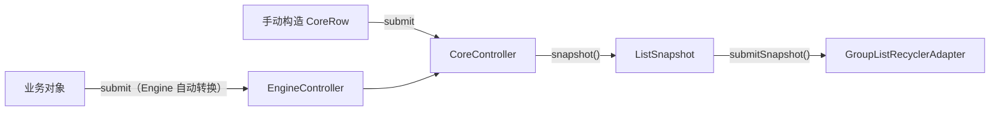

# Android GroupList

一个 Android 分组列表库：分组展开 / 收起、分组头尾、可见性过滤、子项精确刷新，都由库统一管理，RecyclerView 侧获得精确的 INSERT / REMOVE / UPDATE 通知。

整条链路只有一行：

```text
业务对象 -> Engine -> ListSnapshot -> RecyclerView Adapter
```

**其他文档：**

- 想了解库内部原理 → [docs/how-it-works.md](docs/how-it-works.md)
- 想顺着真实示例学习 → [app/README.md](app/README.md)
- 各模块入口：
  - [grouplist-core](grouplist-core/README.md) —— 核心层（core 状态机 / engine 解释器 / shared 协议），含 Engine 与 Core 两条路径的教程
  - [grouplist-recyclerview](grouplist-recyclerview/README.md) —— RecyclerView 适配层教程（binder 注册、刷新语义、分组查询）
  - [grouplist-compose](grouplist-compose/README.md) —— Compose 适配层教程（GroupListState / ComposeRowRegistry / GroupListLazyColumn）

## 目录

1. [为什么需要这个库](#1-为什么需要这个库)
   - [1.1 场景对比：分页 + 过滤 + 状态保持](#11-场景对比分页--过滤--状态保持)
2. [安装](#2-安装)
3. [核心设计：Core 与 Engine 两层](#3-核心设计core-与-engine-两层)
4. [关键概念](#4-关键概念)
   - [4.1 ListSnapshot](#41-listsnapshot)
   - [4.2 GroupSchema](#42-groupschema)
   - [4.3 EngineCommand](#43-enginecommand)
   - [4.4 viewType 注册](#44-viewtype-注册)
5. [快速接入](#5-快速接入)
   - [5.1 定义 GroupSchema](#51-定义-groupschema)
   - [5.2 构建 controller，注册 schema 与 viewType](#52-构建-controller注册-schema-与-viewtype)
   - [5.3 提交数据](#53-提交数据)
   - [5.4 接到 RecyclerView](#54-接到-recyclerview)
   - [5.5 处理用户交互](#55-处理用户交互)
   - [5.6 已有基类 Adapter？组合接入](#56-已有基类-adapter组合接入)
6. [进阶能力](#6-进阶能力)
7. [构建与测试](#7-构建与测试)
8. [公开契约](#8-公开契约)
9. [License](#9-license)

## 1. 为什么需要这个库

分组列表要同时处理展开 / 收起、过滤、状态保持，手写有大量样板代码。

### 1.1 场景对比：分页 + 过滤 + 状态保持

**场景：** 一个分组评论流，用户可以：

- 展开 / 收起话题分组
- 按关键字过滤分组
- 分页加载
- 旋转屏幕后展开状态不丢

#### 1.1.1 不用 Android-GroupList

```java
// ViewModel：手动维护状态
class FeedViewModel extends ViewModel {
    private Map<String, Boolean> expandedState = new HashMap<>();
    private String currentFilter = "";
    private List<TopicGroup> allGroups = new ArrayList<>();

    void loadPage(int page) {
        repository.loadPage(page, groups -> {
            allGroups.addAll(groups);
            rebuildFlatList();
        });
    }

    void setFilter(String keyword) {
        currentFilter = keyword;
        rebuildFlatList();
    }

    void toggleGroup(String topicId) {
        expandedState.put(topicId, !isExpanded(topicId));
        rebuildFlatList();
    }

    private void rebuildFlatList() {
        List<Object> flat = new ArrayList<>();
        for (TopicGroup group : allGroups) {
            if (!currentFilter.isEmpty() &&
                !group.topic.contains(currentFilter)) {
                continue;
            }
            flat.add(group.header);
            if (isExpanded(group.id)) {
                flat.addAll(group.comments);
                if (group.footer != null) {
                    flat.add(group.footer);
                }
            } else if (group.footer != null && group.showFooterWhenCollapsed) {
                flat.add(group.footer);
            }
        }
        // 手动 diff 或 notifyDataSetChanged
        flatList.setValue(flat);
    }
}

// Adapter：手动分发 viewType
class FeedAdapter extends RecyclerView.Adapter {
    private List<Object> items;

    @Override
    public int getItemViewType(int position) {
        Object item = items.get(position);
        if (item instanceof TopicHeader) return TYPE_HEADER;
        if (item instanceof Comment) return TYPE_COMMENT;
        if (item instanceof TopicFooter) return TYPE_FOOTER;
        throw new IllegalStateException();
    }

    // 还有 3 个 ViewHolder 类和各自的绑定逻辑……
}
```

**问题：**

- 50+ 行手动状态维护和摊平逻辑
- 每个分组操作都要整体重建列表
- 展开状态容易在配置变更后丢失，需要额外的 save / restore
- 没有 RecyclerView 精确通知（notifyDataSetChanged 会打断滚动位置）
- viewType 分发散落在 Adapter 各处

#### 1.1.2 使用 Android-GroupList

```java
// ViewModel：只剩业务逻辑
class FeedViewModel extends ViewModel {
    private final EngineController controller = DefaultEngineController.builder()
        .registerSchema(TopicGroup.class, new TopicGroupSchema())
        .registerGroupHeaderViewType(TopicHeader.class, TYPE_HEADER)
        .registerGroupItemViewType(Comment.class, TYPE_COMMENT)
        .registerGroupFooterViewType(TopicFooter.class, TYPE_FOOTER)
        .setGroupVisibilityResolver((key, group, filter) ->
            filter == null || ((TopicGroup) group).topic.contains((String) filter))
        .build();

    void loadPage(int page) {
        repository.loadPage(page, groups -> {
            // 回调须回主线程执行（单线程契约，见 §8）
            allGroups.addAll(groups);
            // submit 是重载语义：追加一页后展开态会按 initiallyExpanded 重置。
            // 追加时要保住展开态，得走 Core 层的 CoreCommand.ReplaceRows（见 §8 #2）。
            controller.submit(allGroups);  // 一行：剩下的交给库
        });
    }

    void setFilter(String keyword) {
        controller.dispatch(new EngineCommand.SetVisibilityFilter(keyword));
    }

    void toggleGroup(GroupKey key) {
        controller.dispatch(new EngineCommand.ToggleGroup(key));
    }

    ListSnapshot snapshot() {
        return controller.snapshot();
    }

    void markConsumed() {
        controller.takeChangeSet();  // 交付一帧后排水（消费协议，见 §8 #5）
    }
}

// Adapter：消费快照（库提供精确通知）
class FeedAdapter extends GroupListRecyclerAdapter {
    {
        registerBinder(TYPE_HEADER, new TopicHeaderBinder());
        registerBinder(TYPE_COMMENT, new CommentBinder());
        registerBinder(TYPE_FOOTER, new FooterBinder());
    }
}

// Activity / Fragment：把快照接给 adapter，并标记本帧已消费
adapter.submitSnapshot(viewModel.snapshot());
viewModel.markConsumed();
```

**收益：**

- **15 行 vs 50+ 行**：业务逻辑保持干净
- **状态自动管理**：展开、过滤、可见性全部由库接管
- **精确通知**：INSERT / REMOVE / UPDATE 操作，动画流畅
- **状态跨旋转存活**：展开状态在 controller 里，随 ViewModel 存活
- **类型安全的绑定**：viewType 按角色注册一次，自动分发

## 2. 安装

当前已验证的是本地发布到 `Maven Local`。

先发布到本地：

```bash
./gradlew :grouplist-core:publishToMavenLocal :grouplist-recyclerview:publishToMavenLocal :grouplist-compose:publishToMavenLocal
```

发布坐标：

- `groupId`: `io.github.xesam`
- `android-grouplist-core`: 核心层（纯 JVM）
- `android-grouplist-recyclerview`: RecyclerView 适配层
- `android-grouplist-compose`: Compose 适配层（可选）
- `version`: `0.0.1`

然后在你的工程中启用 `mavenLocal()` 并添加依赖：

```kotlin
repositories {
    mavenLocal()
    google()
    mavenCentral()
}

dependencies {
    implementation("io.github.xesam:android-grouplist-core:0.0.1")
    implementation("io.github.xesam:android-grouplist-recyclerview:0.0.1")
    // 可选：Compose 支持
    implementation("io.github.xesam:android-grouplist-compose:0.0.1")
}
```

## 3. 核心设计：Core 与 Engine 两层

| 层 | 输入 | 定位 |
|----|------|------|
| **Engine**（推荐） | 业务对象（`List<?>`） | 按 `GroupSchema` 自动把业务对象转成内部行结构 |
| **Core**（进阶） | 手动构造 `CoreRow` | 需要精确控制每一行结构时的底层通道 |



- **Engine** 是推荐路径：提交业务对象，库自动转成内部行结构，适合普通业务页面。
- **Core** 提供完全手动的行控制，只在 Engine 的约定不满足时使用。

## 4. 关键概念

### 4.1 ListSnapshot

每次 `submit` 或 `dispatch` 之后产出的**只读快照**——把当前所有可见行（standalone / 组头 / 组项 / 组尾）摊平成带 `viewType` 与位置映射的最终列表。Adapter 永远只消费快照，不持有业务状态。

### 4.2 GroupSchema

告诉 Engine "如何理解一个业务分组对象"，6 个方法：

```java
public interface GroupSchema<G, H, C, F> {
    GroupKey keyOf(G group);                   // 稳定唯一标识
    H headerOf(G group);                       // 组头数据
    List<C> childrenOf(G group);                // 子项
    F footerOf(G group);                        // 组尾（可空）
    boolean initiallyExpanded(G group);        // 初始是否展开
    boolean showFooterWhenCollapsed(G group);  // 收起时是否显示组尾
}
```

### 4.3 EngineCommand

意图性状态变更的唯一通道：

```java
controller.dispatch(new EngineCommand.ToggleGroup(key));
controller.dispatch(new EngineCommand.SetGroupExpanded(key, true));
controller.dispatch(new EngineCommand.ReplaceChildren(key, newChildren));
controller.dispatch(new EngineCommand.SetVisibilityFilter(filterPayload));
controller.dispatch(EngineCommand.UpdateStandalone.ofIndex(standaloneIndex, newData));
```

### 4.4 viewType 注册

按角色注册，注册一次、自动分发。每个会出现在页面上的对象类型都需要注册：

```java
DefaultEngineController.builder()
    .registerSchema(TopicGroup.class, new TopicGroupSchema())
    .registerStandaloneViewType(Notice.class, TYPE_NOTICE)        // 普通行（standalone）
    .registerGroupHeaderViewType(String.class, TYPE_HEADER)      // 组头
    .registerGroupItemViewType(Comment.class, TYPE_ITEM)         // 组项
    .registerGroupFooterViewType(String.class, TYPE_FOOTER)     // 组尾
    .build();
```

> `registerViewType(modelClass, viewType)` 是一个便捷方法（同一 viewType 映射到全部角色），生产代码建议优先使用上面的按角色注册。

## 5. 快速接入

最少 4 步。

### 5.1 定义 GroupSchema

```java
class FeedGroupSchema implements GroupSchema<FeedGroup, String, Comment, String> {
    @Override
    public GroupKey keyOf(FeedGroup group) {
        return GroupKey.of("topic:" + group.topicId);
    }

    @Override
    public String headerOf(FeedGroup group) {
        return group.topicTitle;
    }

    @Override
    public List<Comment> childrenOf(FeedGroup group) {
        return group.comments;
    }

    @Override
    public String footerOf(FeedGroup group) {
        return group.hasMore ? "Load more..." : null;
    }

    @Override
    public boolean initiallyExpanded(FeedGroup group) {
        return false; // 默认收起
    }

    @Override
    public boolean showFooterWhenCollapsed(FeedGroup group) {
        return false;
    }
}
```

### 5.2 构建 controller，注册 schema 与 viewType

```java
EngineController controller = DefaultEngineController.builder()
    .registerSchema(FeedGroup.class, new FeedGroupSchema())
    .registerStandaloneViewType(Notice.class, TYPE_NOTICE)
    .registerGroupHeaderViewType(String.class, TYPE_HEADER)
    .registerGroupItemViewType(Comment.class, TYPE_ITEM)
    .registerGroupFooterViewType(String.class, TYPE_FOOTER)
    .build();
```

### 5.3 提交数据

```java
List<FeedGroup> groups = loadFromRepository();
controller.submit(groups);
```

### 5.4 接到 RecyclerView

```java
GroupListRecyclerAdapter adapter = new GroupListRecyclerAdapter()
    .registerBinder(TYPE_NOTICE, new NoticeBinder())
    .registerBinder(TYPE_HEADER, new HeaderBinder())
    .registerBinder(TYPE_ITEM, new CommentBinder())
    .registerBinder(TYPE_FOOTER, new FooterBinder());

recyclerView.setAdapter(adapter);
adapter.submitSnapshot(controller.snapshot());
controller.takeChangeSet();  // 交付一帧即排水
```

### 5.5 处理用户交互

```java
// 展开 / 收起
controller.dispatch(new EngineCommand.ToggleGroup(groupKey));
adapter.submitSnapshot(controller.snapshot());
controller.takeChangeSet();

// 更新子项
controller.dispatch(new EngineCommand.ReplaceChildren(groupKey, newComments));
adapter.submitSnapshot(controller.snapshot());
controller.takeChangeSet();
```

> **交付一帧后必须排水**：`submitSnapshot` 只读取快照携带的 ChangeSet，不排水 controller。
> 漏掉 `takeChangeSet()` 会让 pending 增量跨帧复合，下一帧重复应用上一帧的 ops，
> 真 RecyclerView 会以 "Inconsistency detected" 崩溃（详见 §8 #5）。

### 5.6 已有基类 Adapter？组合接入

公司的 `extends` 名额被自家基类（埋点 / 多类型 / 骨架屏基类）占用时，无法再继承 `GroupListRecyclerAdapter` —— Java 单继承。此时用**组合**接入：自有 Adapter 持有 `SnapshotAdapterDelegate`，转发核心 Adapter 方法（含 payloads 版本的 `onBindViewHolder`）即可获得完全等价的能力（精确通知、版本门、group 状态查询一样不少）：

```java
// 你自己的基类，保持不动
class FeedAdapter extends CompanyBaseAdapter {

    // 唯一实现是 delegate：通知从你自己的实例发出（经 AdapterNotifier 接线）
    private final SnapshotAdapterDelegate delegate =
            new SnapshotAdapterDelegate(new AdapterNotifier(this));

    FeedAdapter(EngineController engine) {
        // 1. 注册 binder：与继承路径完全相同的注册语义
        delegate.registerBinder(TYPE_HEADER, new HeaderBinder())
                .registerBinder(TYPE_ITEM, new CommentBinder())
                .registerBinder(TYPE_FOOTER, new FooterBinder());

        // 2. 展开意图上抛（继承路径的写法是覆写 protected requestSetGroupExpanded 钩子）
        delegate.setOnExpansionRequest((groupKey, expanded) -> {
            engine.dispatch(new EngineCommand.ToggleGroup(groupKey));
            return true;
        });
    }

    // 3. 转发四个核心 Adapter 方法（若 binder 使用 PAYLOAD_CONTENT_UPDATE 做 partial
    //    rebind，把 onBindViewHolder(holder, position, payloads) 这条也转发给 delegate，
    //    否则 payload 增量会退化成全量重绑——示例工程的 DelegatingDemoAdapter 即含此转发）
    @Override public int getItemCount() { return delegate.getItemCount(); }
    @Override public int getItemViewType(int position) { return delegate.getItemViewType(position); }
    @Override public ViewHolder onCreateViewHolder(ViewGroup parent, int viewType) {
        LayoutInflater inflater = LayoutInflater.from(parent.getContext());
        return delegate.onCreateViewHolder(inflater, parent, viewType);
    }
    @Override public void onBindViewHolder(ViewHolder holder, int position) {
        delegate.onBindViewHolder(holder, position);
    }
    @Override public void onBindViewHolder(ViewHolder holder, int position, List<Object> payloads) {
        delegate.onBindViewHolder(holder, position, payloads);
    }

    // 4. 提交快照 / 查询 group 状态（GroupState 是 core 下沉的共享类型）
    void submit(ListSnapshot snapshot) { delegate.submitSnapshotWithGroupChrome(snapshot); }
    GroupState groupState(GroupKey key) { return delegate.getGroupState(key); }
}
```

两条路径的对应关系与取舍：

| | 继承（`GroupListRecyclerAdapter`） | 组合（`SnapshotAdapterDelegate`） |
|---|---|---|
| 适用 | 新页面，快速接入 | 存量基类 Adapter，`extends` 名额被占用 |
| 展开 | 覆写 protected `requestSetGroupExpanded` 钩子 | `setOnExpansionRequest` 回调 |
| 定制通知 | 覆写 protected `notifyXxxCompat` 族 | 直接实现 `SnapshotAdapterDelegate.Notifier` |
| 行为等价性 | 同一份实现，两套测试覆盖各自的接入面 | 同左 |

> **关于"等价"**：门面是纯转发，`SnapshotAdapterDelegate` 是本层唯一实现——不存在第二份实现可供对照，
> 因此这里说的是"同一实现、两个入口"，而非"两份实现互证等价"。两套测试各自钉住只有本入口会坏的接线：
> facade 套件覆盖 `CompatNotifier` → protected 钩子的桥接，delegate 套件覆盖 Notifier 回调通路与
> `setOnExpansionRequest` 语义。

> 可运行的完整组合接入示例见示例 App 的「组合接入示例页」（`DelegateDemoActivity` + `DelegatingDemoAdapter`），与 Engine 示例页共用同一份 ViewModel，只有渲染接入方式不同。内部结构见 [docs/how-it-works.md](docs/how-it-works.md) §5.5。

## 6. 进阶能力

第一次使用可以先跳过本节。

- `registerViewTypeResolver(key, resolver)`：动态决定 `viewType`（例如把 loading item 映射到骨架屏布局）
- `setGroupVisibilityResolver(...)`：配合 `SetVisibilityFilter`，按筛选条件决定分组是否可见，无需重建列表：

```java
controller = DefaultEngineController.builder()
    .setGroupVisibilityResolver((key, group, filter) -> {
        if (filter == null) return true;
        return ((FeedGroup) group).topicTitle.contains((String) filter);
    })
    .build();

// 应用过滤
controller.dispatch(new EngineCommand.SetVisibilityFilter("kotlin"));
adapter.submitSnapshot(controller.snapshot());
controller.takeChangeSet();
```

- **展开状态跨过滤存活**：被隐藏的分组记住自己的展开状态，重新可见时自动带出
- **精确 ChangeSet 通知**：库产出细粒度 INSERT / REMOVE / UPDATE 操作，adapter 消费 `snapshot` 携带的 ChangeSet，RecyclerView 得到 `notifyItemInserted/Removed/Changed`，动画流畅
- **状态保持**：展开状态放在 controller 里，随 ViewModel 跨配置变更存活，无需手写 `onSaveInstanceState`
- `setCoreRowFactory(...)`：自定义 Engine 到 Core 的转换策略
- **Compose 支持**：`GroupListState` 包装 Core 层 controller，`GroupListLazyColumn` 渲染快照：

```kotlin
val state = remember { GroupListState() }
val registry = remember {
    ComposeRowRegistry().apply {
        register<CommentHeaderUi>(TYPE_HEADER) { row -> HeaderContent(row) }
        register<CommentUi>(TYPE_ITEM) { row -> CommentContent(row) }
    }
}

GroupListLazyColumn(
    state = state,
    registry = registry
)

state.submit(coreRows)                 // 提交 CoreRow 列表
state.toggleGroup(groupKey)           // 展开 / 收起
```

## 7. 构建与测试

```bash
# 运行全部测试（core 是纯 JVM 模块；两个 Android 模块为 testDebugUnitTest）
./gradlew :grouplist-core:test :grouplist-recyclerview:testDebugUnitTest :grouplist-compose:testDebugUnitTest

# 只跑核心层测试
./gradlew :grouplist-core:test

# 发布到 Maven Local
./gradlew publishToMavenLocal
```

核心测试：

- [DefaultCoreControllerTest.java](grouplist-core/src/test/java/io/github/xesam/android/grouplist/vnext/core/DefaultCoreControllerTest.java)
- [DefaultEngineControllerTest.java](grouplist-core/src/test/java/io/github/xesam/android/grouplist/vnext/engine/DefaultEngineControllerTest.java)

## 8. 公开契约

1. **展开状态单一事实源**：只在 controller 里，通过 `controller.isGroupExpanded(key)` 查询，业务方不要再持有第二份副本。

2. **`submit()` 重置展开状态**：完整重载语义，收平全部展开状态到初始值。过滤（`SetVisibilityFilter`）、子项替换（`ReplaceChildren`）、standalone 局部更新（`UpdateStandalone`）走 `EngineCommand` 增量通道，展开意图跨命令、跨隐藏存活。**逐页追加行不在其中**：`EngineCommand` 没有追加命令，用 `submit` 追加会把展开态一起重置。追加又要保住展开态，目前只能下到 Core 层用 `CoreCommand.ReplaceRows`（键控全量 reconcile，不清展开态，允许 standalone 增删与移动）。

3. **`GroupKey` 必须稳定**：key 跨过滤、跨隐藏期持续有效，是展开状态 map 的键；不要用时间戳、自增序号、内容哈希等动态成分作 key。

4. **线程契约**：controller 非线程安全，`submit / dispatch / snapshot` 须在单线程（通常是主线程）调用。

5. **ChangeSet 消费协议**：连续 `dispatch` 不消费会累积操作；`snapshot()` 是纯只读可重复读，`hasPendingChanges()` 非消费探测，`takeChangeSet()` 是唯一消费点（取走并清空 pending）。

## 9. License

Apache 2.0
