# 示例工程（app）

这是 [Android GroupList](../README.md) 库的示例工程。这里的文档面向**想读懂示例、顺着真实数据流学习的读者**；如果你想了解库本身的核心设计与接入方式，请看[项目根 README](../README.md)。

最容易理解这个库的方式，不是先看抽象设计，而是顺着示例工程走一遍真实数据流。

如果你第一次接触这个项目，建议直接按下面顺序阅读：

1. [FeedRepository.java](src/main/java/io/github/xesam/android/grouplist/example/data/repository/FeedRepository.java)
2. [FeedRowMapper.java](src/main/java/io/github/xesam/android/grouplist/example/ui/mapper/FeedRowMapper.java)
3. [BaseDemoViewModel.java](src/main/java/io/github/xesam/android/grouplist/example/ui/common/BaseDemoViewModel.java)
4. [EngineDemoViewModel.java](src/main/java/io/github/xesam/android/grouplist/example/ui/engine/EngineDemoViewModel.java)
5. [DemoUiAdapter.java](src/main/java/io/github/xesam/android/grouplist/example/ui/common/DemoUiAdapter.java)

读完这 5 个文件，你就能知道：

- 数据从哪里来
- 怎么变成分组列表需要的结构
- 展开 / 收起时状态在哪里变化
- 快照是怎么交给 `RecyclerView` 的

如果你想单独了解库内部原理，而不关心 demo，可以看：

- [docs/how-it-works.md](../docs/how-it-works.md)

## 目录

1. [跑起来](#1-跑起来)
2. [从 Repo 到 Adapter：一步步看示例](#2-从-repo-到-adapter一步步看示例)
   - [2.1 先看整条对象流转](#21-先看整条对象流转)
   - [2.2 第 1 步：Repository 提供后端数据](#22-第-1-步repository-提供后端数据)
   - [2.3 第 2 步：Mapper 把后端模型转成 UI 语义对象](#23-第-2-步mapper-把后端模型转成-ui-语义对象)
   - [2.4 第 3 步：BaseDemoViewModel 持有当前源数据和交互状态](#24-第-3-步basedemoviewmodel-持有当前源数据和交互状态)
   - [2.5 第 4 步：EngineDemoViewModel 把 sourceRows 交给库](#25-第-4-步enginedemoviewmodel-把-sourcerows-交给库)
   - [2.6 第 5 步：Adapter 消费 ListSnapshot](#26-第-5-步adapter-消费-listsnapshot)
3. [照着示例接入：最少要做什么](#3-照着示例接入最少要做什么)
   - [3.1 准备业务行列表](#31-准备业务行列表)
   - [3.2 为分组对象定义 GroupSchema](#32-为分组对象定义-groupschema)
   - [3.3 注册 viewType](#33-注册-viewtype)
   - [3.4 提交快照给 Adapter](#34-提交快照给-adapter)
4. [完整接入示例代码](#4-完整接入示例代码)
5. [使用过程中顺便理解原理](#5-使用过程中顺便理解原理)
6. [Core 示例](#6-core-示例)
7. [组合接入示例（自有基类 + Delegate）](#7-组合接入示例自有基类--delegate)

## 1. 跑起来

构建并安装示例应用：

```bash
./gradlew :app:assembleDebug --no-daemon
```

示例入口：

- [MainActivity.java](src/main/java/io/github/xesam/android/grouplist/example/ui/MainActivity.java)

推荐先看默认路径：

- [EngineDemoActivity.java](src/main/java/io/github/xesam/android/grouplist/example/ui/engine/EngineDemoActivity.java)

进阶路径：

- [CoreDemoActivity.java](src/main/java/io/github/xesam/android/grouplist/example/ui/core/CoreDemoActivity.java)
- [DelegateDemoActivity.java](src/main/java/io/github/xesam/android/grouplist/example/ui/delegate/DelegateDemoActivity.java)（组合接入，见 §7）

默认建议先学 `Engine`，因为它更接近真实业务接入方式。

## 2. 从 Repo 到 Adapter：一步步看示例

下面按示例工程里的真实文件，走一遍完整流程。

### 2.1 先看整条对象流转

```mermaid
flowchart LR
    A[FeedRepository.loadInitialRows<br/>List&lt;FeedBackendModels.BackendRow&gt;]
    B[FeedRowMapper.mapBackendRowsToUiRows<br/>List&lt;FeedUiModels.TopLevelRow&gt;]
    C[BaseDemoViewModel.sourceRows]
    D[EngineDemoViewModel.submitSourceRowsToEngine<br/>List&lt;Object&gt;]
    E[DefaultEngineController]
    F[ListSnapshot]
    G[DemoUiAdapter]
    H[RecyclerView]

    A --> B
    B --> C
    C --> D
    D --> E
    E --> F
    F --> G
    G --> H
```



如果你只想先抓住主线，就记住这条：

`FeedBackendModels.BackendRow -> FeedUiModels.TopLevelRow -> sourceRows -> DefaultEngineController -> ListSnapshot -> DemoUiAdapter`

### 2.2 第 1 步：Repository 提供后端数据

文件：

- [FeedRepository.java](src/main/java/io/github/xesam/android/grouplist/example/data/repository/FeedRepository.java)

这里返回的是最原始的"后端行"：

- `StandaloneCard`
- `FilterEntry`
- `CommentGroup`
- `TopicGroup`

这一步的重点不是 UI，而是模拟服务端返回的数据形态。

### 2.3 第 2 步：Mapper 把后端模型转成 UI 语义对象

文件：

- [FeedRowMapper.java](src/main/java/io/github/xesam/android/grouplist/example/ui/mapper/FeedRowMapper.java)

这里做了第一层真正有意义的转换。

它把 `FeedBackendModels.BackendRow` 转成 `FeedUiModels.TopLevelRow`：

- `StandaloneCard` -> `StandaloneUiModel`
- `FilterEntry` -> `StandaloneUiModel(GroupFilterCard)`
- `CommentGroup` -> `GroupUiModel`
- `TopicGroup` -> `GroupUiModel`

这一步做了两件关键事情：

1. 把后端数据整理成更适合 UI 的对象
2. 提前确定一部分 `viewType`

例如：

- 普通公告行会变成 `StandaloneUiModel(..., FeedViewTypes.TYPE_STANDALONE)`
- 筛选卡会变成 `StandaloneUiModel(..., FeedViewTypes.TYPE_FILTER_STANDALONE)`

### 2.4 第 3 步：BaseDemoViewModel 持有当前源数据和交互状态

文件：

- [BaseDemoViewModel.java](src/main/java/io/github/xesam/android/grouplist/example/ui/common/BaseDemoViewModel.java)

这个类是整个示例流程的中枢。

它做的事情是：

1. 调 `FeedRepository.loadInitialRows()`
2. 调 `FeedRowMapper.mapBackendRowsToUiRows(...)`
3. 把结果放进 `sourceRows`
4. 建立 `groupsByKey`
5. 在用户点击展开 / 收起时，向控制器发出意图命令（控制层持有展开状态）
6. 在分组展开后模拟异步加载，再把 loading item 替换成真实数据

这里最重要的是理解两个字段：

- `sourceRows`：当前页面真正的源数据
- `groupsByKey`：按 `GroupKey` 索引分组，方便后续展开 / 加载 / 替换

### 2.5 第 4 步：EngineDemoViewModel 把 sourceRows 交给库

文件：

- [EngineDemoViewModel.java](src/main/java/io/github/xesam/android/grouplist/example/ui/engine/EngineDemoViewModel.java)

这是默认推荐的接入方式。

这里要重点看两个方法：

#### `createEngineController()`

它定义了库如何理解你的业务对象：

- `registerSchema(FeedUiModels.GroupUiModel.class, new UiGroupSchema())`
- `registerStandaloneViewType(...)`
- `registerGroupHeaderViewType(...)`
- `registerGroupItemViewType(...)`
- `registerGroupFooterViewType(...)`

这一步的意思是：

- 哪些对象是 group
- group 的 header / item / footer 分别是什么
- 每种对象应该用哪个 `viewType`

可以把 `createEngineController()` 理解成 3 层配置：

1. `registerSchema(...)`
   - 解决"结构问题"
   - 告诉库：哪个对象是 group，以及这个 group 的 `key/header/children/footer` 分别是什么
2. `registerStandaloneViewType(...) / registerGroupHeaderViewType(...) / registerGroupItemViewType(...) / registerGroupFooterViewType(...)`
   - 解决"渲染问题"
   - 告诉库：这些对象进入不同角色后，该用哪个 `viewType`
3. `registerViewTypeResolver(...) / setGroupVisibilityResolver(...)`
   - 解决"运行时规则问题"
   - 前者用于动态改写某些 item 的 `viewType`，例如示例里把 loading item 映射到骨架屏布局
   - 后者用于根据筛选条件决定 group 是否可见

结合示例代码理解：

- `registerSchema(FeedUiModels.GroupUiModel.class, new UiGroupSchema())`
  - 表示 `FeedUiModels.GroupUiModel` 是一个分组对象
- `registerGroupHeaderViewType(FeedUiModels.CommentHeader.class, FeedViewTypes.TYPE_GROUP_HEADER)`
  - 表示评论分组的 header 是 `CommentHeader`，渲染时走普通评论头布局
- `registerGroupHeaderViewType(FeedUiModels.TopicHeader.class, FeedViewTypes.TYPE_TOPIC_GROUP_HEADER)`
  - 表示投票分组的 header 是 `TopicHeader`，渲染时走投票头布局
- `registerViewTypeResolver("loading-state", ...)`
  - 表示当 item 处于 loading 状态时，不走普通 item 布局，而走 loading 布局

如果少了这一步，库并不知道：

- 一个对象是不是 group
- group 内部拆成哪几部分
- 每一部分该怎么渲染

#### `submitSourceRowsToEngine()`

它把 `sourceRows` 转成 `List<Object>` 后直接提交给库：

```java
engineController.submit(rows);
```

注意这里没有手写 `CoreRow`。

这正是 `Engine` 的价值：

- 你提交业务对象
- 库根据 `GroupSchema` 和 `viewType` 注册规则，自动转成内部行结构

用户交互时：

- 展开 / 收起：`EngineCommand.ToggleGroup`（展开状态存于控制器层单一事实源）
- 替换 children：`EngineCommand.ReplaceChildren`（隐藏期间静默缓存 override，重现时带出）
- 过滤：`EngineCommand.SetVisibilityFilter`（可见性窄化：块级精确差分，
  展开意图跨隐藏存活——切换过滤不再收起已展开的组）
- 修改 standalone 内容：`EngineCommand.UpdateStandalone.ofIndex/ofData`（原地 UPDATE，
  与 `submit` 重置展开的那条水道完全分立；`ofIndex` 精确按槽序，`ofData` 便捷按 equals）

### 2.6 第 5 步：Adapter 消费 ListSnapshot

文件：

- [DemoUiAdapter.java](src/main/java/io/github/xesam/android/grouplist/example/ui/common/DemoUiAdapter.java)

这里是最后一步：真正把快照渲染到 `RecyclerView`。

这个类基于：

- [GroupListRecyclerAdapter.java](../grouplist-recyclerview/src/main/java/io/github/xesam/android/grouplist/recyclerview/adapter/GroupListRecyclerAdapter.java)

你在 `DemoUiAdapter` 里会看到：

- 它在构造时安装了所有 binder（binder / Holder 的真实实现在 [FeedItemBinders.java](src/main/java/io/github/xesam/android/grouplist/example/ui/common/FeedItemBinders.java)，与组合路径示例共用同一份）
- 不同 `viewType` 对应不同布局和绑定逻辑
- `submitSnapshot(...)` 最终走的是 `submitSnapshotWithGroupChrome(...)`

这一步不再关心后端模型和分组规则，只关心三件事：

- `row.data()`
- `row.viewType()`
- `row.mapping()`

## 3. 照着示例接入：最少要做什么

如果你要在自己的项目里接入，最少只需要做 4 件事。（库层面的概念定义见[根 README §4](../README.md#4-关键概念)。）

### 3.1 准备业务行列表

你的页面需要有一份类似 `sourceRows` 的列表。

这份列表里可以同时包含：

- 普通行
- 分组对象

示例参考：

- [BaseDemoViewModel.java](src/main/java/io/github/xesam/android/grouplist/example/ui/common/BaseDemoViewModel.java)

### 3.2 为分组对象定义 GroupSchema

示例参考：

- [EngineDemoViewModel.java](src/main/java/io/github/xesam/android/grouplist/example/ui/engine/EngineDemoViewModel.java)

`UiGroupSchema` 这段代码就是最直接的模板。

你要告诉库：

- 分组 key 是什么
- header 是什么
- children 是什么
- footer 是什么
- 默认是否展开

### 3.3 注册 viewType

还是看：

- [EngineDemoViewModel.java](src/main/java/io/github/xesam/android/grouplist/example/ui/engine/EngineDemoViewModel.java)

你需要把会出现在页面上的对象类型全部注册好，例如（示例里的真实注册）：

- `FeedUiModels.StandaloneCardUi`（standalone 卡片）
- `FeedUiModels.GroupFilterCard`（筛选条 standalone）
- `FeedUiModels.CommentHeader`（评论组头）
- `FeedUiModels.TopicHeader`（投票组头）
- `FeedUiModels.FeedCommentItem` / `FeedUiModels.TopicOptionItem`（组子项）
- `FeedUiModels.TopicFooter` / `String`（组尾）

### 3.4 提交快照给 Adapter

示例参考：

- [EngineDemoActivity.java](src/main/java/io/github/xesam/android/grouplist/example/ui/engine/EngineDemoActivity.java)
- [DemoUiAdapter.java](src/main/java/io/github/xesam/android/grouplist/example/ui/common/DemoUiAdapter.java)

核心代码就是：

```java
controller.submit(rows);
adapter.submitSnapshot(controller.snapshot());
controller.takeChangeSet();   // 交付一帧后必须排水（消费协议）
```

如果你需要更好的组头 / 组尾刷新效果，像示例一样使用：

```java
adapter.submitSnapshotWithGroupChrome(controller.snapshot());
controller.takeChangeSet();
```

## 4. 完整接入示例代码

下面这段代码取自 [EngineDemoViewModel.java](src/main/java/io/github/xesam/android/grouplist/example/ui/engine/EngineDemoViewModel.java) 的真实写法（loading-state resolver 与 visibility resolver 的完整实现见源码，此处略）。

```java
DefaultEngineController controller = DefaultEngineController.builder()
        .registerSchema(FeedUiModels.GroupUiModel.class, new UiGroupSchema())
        .registerStandaloneViewType(FeedUiModels.StandaloneCardUi.class, FeedViewTypes.TYPE_STANDALONE)
        .registerStandaloneViewType(FeedUiModels.GroupFilterCard.class, FeedViewTypes.TYPE_FILTER_STANDALONE)
        .registerGroupHeaderViewType(FeedUiModels.CommentHeader.class, FeedViewTypes.TYPE_GROUP_HEADER)
        .registerGroupHeaderViewType(FeedUiModels.TopicHeader.class, FeedViewTypes.TYPE_TOPIC_GROUP_HEADER)
        .registerGroupItemViewType(FeedUiModels.FeedCommentItem.class, FeedViewTypes.TYPE_GROUP_ITEM)
        .registerGroupItemViewType(FeedUiModels.TopicOptionItem.class, FeedViewTypes.TYPE_TOPIC_GROUP_ITEM)
        .registerGroupFooterViewType(String.class, FeedViewTypes.TYPE_GROUP_FOOTER)
        .registerGroupFooterViewType(FeedUiModels.TopicFooter.class, FeedViewTypes.TYPE_TOPIC_GROUP_FOOTER)
        .registerViewTypeResolver("loading-state", (role, model) -> { /* 略 */ })
        .setGroupVisibilityResolver((groupKey, group, filterPayload) -> { /* 略 */ })
        .build();

DemoUiAdapter adapter = new DemoUiAdapter(
        mode -> {},
        groupKey -> controller.dispatch(new EngineCommand.ToggleGroup(groupKey))
);

controller.submit(rows);
adapter.submitSnapshotWithGroupChrome(controller.snapshot());
controller.takeChangeSet();   // 真实写法见 BaseDemoViewModel.publishState()：交付后排水
```

## 5. 使用过程中顺便理解原理

只需要记住下面 4 个点。

1. `Repository` 负责原始数据
2. `Mapper` 负责把数据整理成 UI 更容易使用的结构
3. `Controller` 负责展开 / 收起 / 过滤 / children 替换
4. `Adapter` 只负责渲染快照，不负责业务状态

所以这个库的核心思想其实并不复杂：

- 业务数据和渲染数据分开
- 分组状态由 Controller 维护
- Adapter 永远只消费最终快照

## 6. Core 示例

只有在你明确需要"自己手写每一行的结构"时，才直接用 `Core`。

示例参考：

- [CoreDemoViewModel.java](src/main/java/io/github/xesam/android/grouplist/example/ui/core/CoreDemoViewModel.java)

和 `Engine` 的区别是：

- `Engine`：提交业务对象，库自动转内部行结构
- `Core`：你自己直接构造 `CoreRow`

## 7. 组合接入示例（自有基类 + Delegate）

`DemoUiAdapter` 走的是**继承路径**（`extends GroupListRecyclerAdapter`）。真实项目里很多团队已经有自己的基类 Adapter（统一埋点 / 多类型 / 骨架屏），`extends` 名额被占用——这时用**组合路径**接入：

- [DelegateDemoActivity.java](src/main/java/io/github/xesam/android/grouplist/example/ui/delegate/DelegateDemoActivity.java)
- [DelegatingDemoAdapter.java](src/main/java/io/github/xesam/android/grouplist/example/ui/delegate/DelegatingDemoAdapter.java)
- [DemoBaseAdapter.java](src/main/java/io/github/xesam/android/grouplist/example/ui/delegate/DemoBaseAdapter.java)（模拟的“公司存量基类”）

这个示例页与 Engine 示例页**共用同一个 `EngineDemoViewModel`**：数据层、状态层、交互行为完全一致（可以对照着点，展开 / 过滤 / 加载行为一模一样），只有渲染接入方式不同：

```java
// 关键差异（DemoUiAdapter vs DelegatingDemoAdapter）：
// 继承：class DemoUiAdapter extends GroupListRecyclerAdapter
// 组合：class DelegatingDemoAdapter extends DemoBaseAdapter      ← 名额给自家基类
//         + delegate = new SnapshotAdapterDelegate(new AdapterNotifier(this))

// 展开意图上抛：
// 继承：@Override protected boolean requestSetGroupExpanded(...)
// 组合：delegate.setOnExpansionRequest((groupKey, expanded) -> { ... })
```

两条路径共享同一份实现（`SnapshotAdapterDelegate`，门面为其纯转发），精确通知、版本门、展开态 chrome 一致；两套测试分别覆盖只有本入口会坏的接线。接入步骤的完整讲解见 [recyclerview 模块 README](../grouplist-recyclerview/README.md) §6 与 [docs/how-it-works.md](../docs/how-it-works.md) §5.5。
