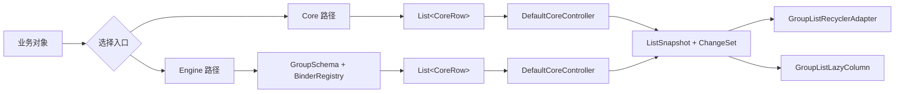
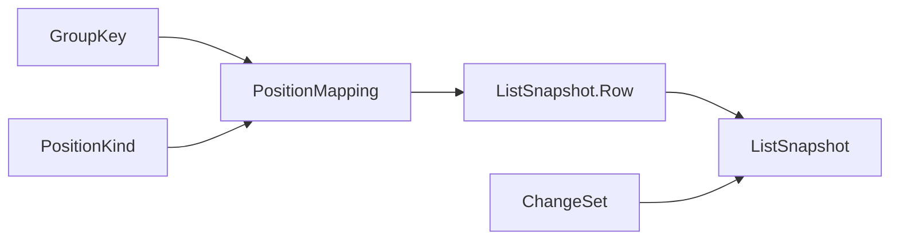
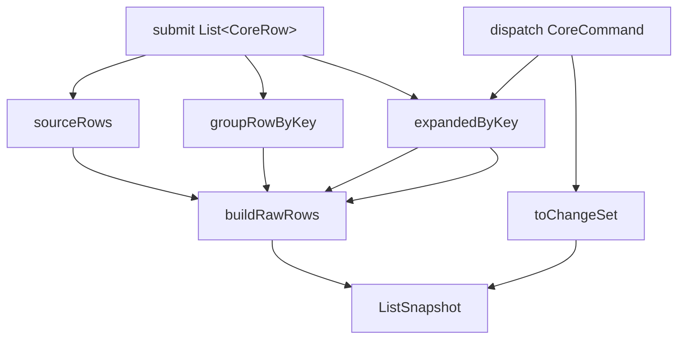
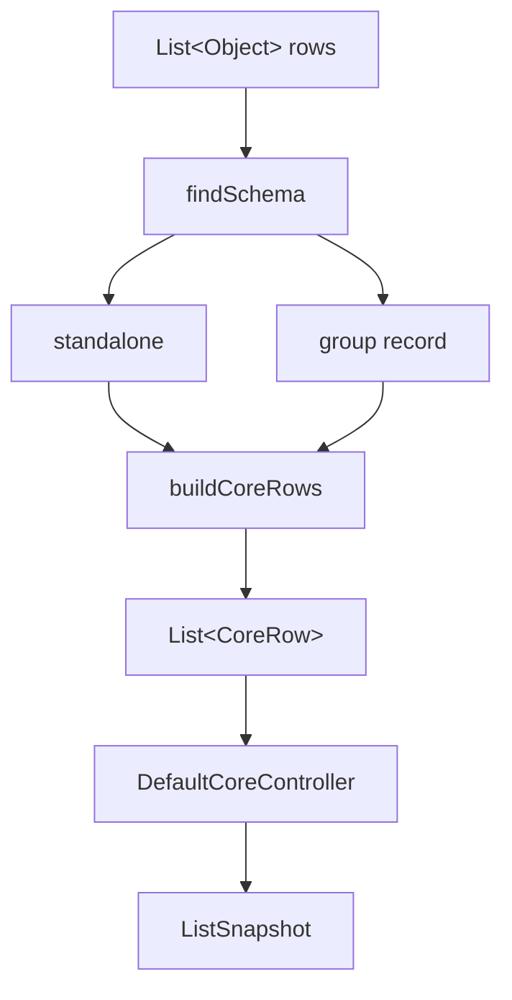
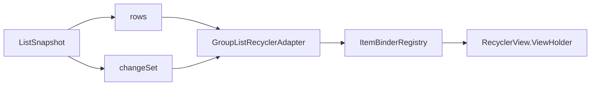
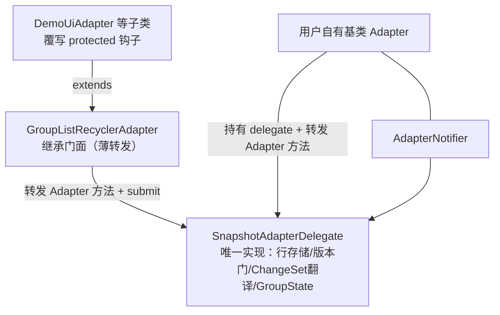
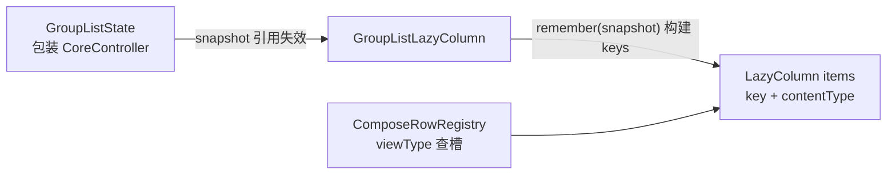
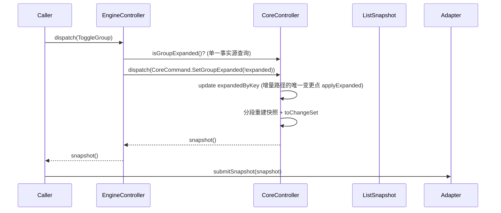

# Android GroupList: How It Works

这份文档只讨论库本身的工作原理，不依赖 demo 示例。

目标是解释 4 个问题：

1. 库内部有哪些核心对象
2. `Core` 和 `Engine` 分别负责什么
3. 一次 `submit` / `dispatch` 之后，快照是怎样产生的
4. `RecyclerView` 层如何消费快照

## 目录

1. [总览](#1-总览)
   - [1.1 Core / Engine 双路径](#11-core--engine-双路径)
2. [Shared 层：统一协议](#2-shared-层统一协议)
   - [2.1 GroupKey](#21-groupkey)
   - [2.2 PositionMapping](#22-positionmapping)
   - [2.3 ListSnapshot](#23-listsnapshot)
   - [2.4 ChangeSet](#24-changeset)
3. [Core 层：最小状态机](#3-core-层最小状态机)
   - [3.1 CoreRow](#31-corerow)
   - [3.2 DefaultCoreController 内部状态](#32-defaultcorecontroller-内部状态)
   - [3.3 submit(...) 做了什么](#33-submit-做了什么)
   - [3.4 dispatch(...) 做了什么](#34-dispatch-做了什么)
   - [3.5 快照构建 buildRawRows(...)](#35-快照构建-buildrawrows)
   - [3.6 ChangeSet 为什么能算出来](#36-changeset-为什么能算出来)
4. [Engine 层：业务对象解释器](#4-engine-层业务对象解释器)
   - [4.1 GroupSchema](#41-groupschema)
   - [4.2 BinderRegistry](#42-binderregistry)
   - [4.3 DefaultEngineController 内部状态](#43-defaultenginecontroller-内部状态)
   - [4.4 submit(...) 做了什么](#44-submit-做了什么)
   - [4.5 buildCoreRows() 做了什么](#45-buildcorerows-做了什么)
   - [4.6 dispatch(...) 做了什么](#46-dispatch-做了什么)
5. [RecyclerView 层：快照消费者](#5-recyclerview-层快照消费者)
   - [5.1 GroupListRecyclerAdapter 的输入](#51-grouplistrecycleradapter-的输入)
   - [5.2 submitSnapshot(...)](#52-submitsnapshot)
   - [5.3 submitSnapshotWithGroupChrome(...)](#53-submitsnapshotwithgroupchrome)
   - [5.4 为什么 Adapter 还提供 group 查询 API](#54-为什么-adapter-还提供-group-查询-api)
   - [5.5 继承与组合双入口](#55-继承与组合双入口)
6. [Compose 层：另一种快照消费者](#6-compose-层另一种快照消费者)
   - [6.1 GroupListState：可观察包装](#61-groupliststate可观察包装)
   - [6.2 ComposeRowRegistry：渲染槽与冻结契约](#62-composerowregistry渲染槽与冻结契约)
   - [6.3 GroupListLazyColumn：键策略与渲染入口](#63-grouplistlazycolumn键策略与渲染入口)
   - [6.4 与 RecyclerView 层消费者的差异](#64-与-recyclerview-层消费者的差异)
7. [一次典型交互的完整流转](#7-一次典型交互的完整流转)
   - [7.1 Engine 路径](#71-engine-路径)
   - [7.2 Core 路径](#72-core-路径)
8. [为什么会有多层转换](#8-为什么会有多层转换)
9. [线程模型](#9-线程模型)
10. [适用场景](#10-适用场景)
    - [10.1 适合使用 Engine](#101-适合使用-engine)
    - [10.2 适合使用 Core](#102-适合使用-core)
    - [10.3 如何选择渲染层](#103-如何选择渲染层)
11. [总结](#11-总结)

## 1. 总览

从内部结构看，这个库可以分成 5 层：

1. `shared`
2. `core`
3. `engine`
4. `recyclerview`
5. `compose`

对应职责是：

- `shared`：统一的数据交换协议
- `core`：最小状态机，负责展开 / 收起和快照生成
- `engine`：把业务对象解释成 `Core` 能理解的结构
- `recyclerview`：消费快照并完成渲染（精确通知路径）
- `compose`：消费快照并完成渲染（可重组路径）

如果只记一句话，可以记这个：

`Engine/Core` 负责产出 `ListSnapshot`，`recyclerview` / `compose` 两个渲染适配层负责消费 `ListSnapshot`。

### 1.1 Core / Engine 双路径



## 2. Shared 层：统一协议

关键类：

- [GroupKey.java](../grouplist-core/src/main/java/io/github/xesam/android/grouplist/vnext/shared/GroupKey.java)
- [PositionKind.java](../grouplist-core/src/main/java/io/github/xesam/android/grouplist/vnext/shared/PositionKind.java)
- [PositionMapping.java](../grouplist-core/src/main/java/io/github/xesam/android/grouplist/vnext/shared/PositionMapping.java)
- [ChangeSet.java](../grouplist-core/src/main/java/io/github/xesam/android/grouplist/vnext/shared/ChangeSet.java)
- [ListSnapshot.java](../grouplist-core/src/main/java/io/github/xesam/android/grouplist/vnext/shared/ListSnapshot.java)

这一层的作用是让库内部和 UI 层用同一种语言交流。



### 2.1 GroupKey

`GroupKey` 是分组唯一标识。

它的作用不是 UI 文案，不是位置，也不是业务对象本身。它只解决一件事：

- 用一个稳定标识找到“这一个 group”

所有和 group 相关的状态变化，最终都围绕 `GroupKey` 展开。

### 2.2 PositionMapping

`PositionMapping` 描述一行在当前快照中的语义位置。

它通常包含：

- `flatPosition`
- `kind`
- `groupKey`
- `childIndex`

这里的重点是：

- `flatPosition` 是当前快照里的扁平位置
- `kind` 说明这行到底是 standalone、group header、group item 还是 group footer
- `groupKey` 用于把这行归属到某个分组
- `childIndex` 只对 group item 有意义

### 2.3 ListSnapshot

`ListSnapshot` 是整个库最重要的输出对象。

它包含两部分：

- `rows`
- `changeSet`

其中每一行都是 `ListSnapshot.Row<T>`：

- `mapping`
- `data`
- `viewType`

这意味着 UI 层只需要知道：

- 这一行是什么数据
- 这一行该用什么 `viewType`
- 这一行在语义上属于什么位置

### 2.4 ChangeSet

`ChangeSet` 不是新数据本身，而是“这次变化相对上一次发生了什么”。

它携带通道标记 `Channel`，语义不可互混：

- `Channel.RELOAD`（仅由 `submit` 产生）：整表重载，operations 恒为空；消费者
  整体重建（adapter 对应 `notifyDataSetChanged`）；
- `Channel.INCREMENTAL`（一切精确通道）：可能为空——空表示“本次无任何可见
  变化”，消费者不得发起任何重绘；非空时按 ops 做局部刷新。

消费协议（`CoreController`）：

- `snapshot()`：纯只读、非消费式，可重复读；
- `hasPendingChanges()`：非消费探测；
- `takeChangeSet()`：唯一消费点，取走并清空 pending；fail-silent no-op 分发
  不会动 pending，pending 也不会因为忘了清空而被重复消费。

这样 UI 可以做局部刷新，而不是每次都全量 `notifyDataSetChanged()`；而真正
的“什么都没发生”也绝不会再触发任何通知。

#### 2.4.1 坐标系约定（公开契约，成文于 `ChangeSet` javadoc）

- 消费者按 operations 顺序逐条应用，每条 operation 的 positionStart 以
  “之前各条已应用后的列表状态”为坐标系（同 Android DiffUtil/RecyclerView
  顺序通知惯例；`SnapshotAdapterDelegate#applyChangeSet` 的 for 循环即此语义，
  门面 `GroupListRecyclerAdapter` 经 delegate 转发共享同一实现）。
  不存在“旧坐标/新坐标”双坐标概念。
- reconcile 通道（`DefaultCoreController#handleReconcileRows`）的发射顺序：同一批
  差分中先按旧位置降序 REMOVE，再按升序 INSERT，最后按终坐标升序 UPDATE
  （前半段 REMOVE/INSERT 顺序承诺亦成文于 `ChangeSet` javadoc）；该顺序下每条
  坐标自洽。`ReplaceRows` 通道（`RowDiff` 单次前向扫描）的发射顺序与此不同
  （prefix 内容 UPDATE 先行，middle 段 REMOVE/INSERT/UPDATE 按位置交错，tail
  内容 UPDATE 收尾），但同样满足顺序应用坐标系，不等价于该批量顺序承诺。
- 顺次应用等价性有专门的不变量测试把关：对旧 rows 顺次
  模拟应用全部 operations，终态必须与对应新快照一致。

## 3. Core 层：最小状态机

关键类：

- [CoreRow.java](../grouplist-core/src/main/java/io/github/xesam/android/grouplist/vnext/core/CoreRow.java)
- [CoreCommand.java](../grouplist-core/src/main/java/io/github/xesam/android/grouplist/vnext/core/CoreCommand.java)
- [CoreController.java](../grouplist-core/src/main/java/io/github/xesam/android/grouplist/vnext/core/CoreController.java)
- [DefaultCoreController.java](../grouplist-core/src/main/java/io/github/xesam/android/grouplist/vnext/core/DefaultCoreController.java)

`Core` 的职责非常纯粹：

- 接收一组结构化的行
- 维护 group 的展开状态
- 生成当前快照
- 在状态变化时给出增量变化



### 3.1 CoreRow

`CoreRow` 是 `Core` 层的输入对象。

分成两种：

- `CoreRow.Standalone`
- `CoreRow.Group`

`Standalone` 只需要：

- `data`
- `viewType`

`Group` 需要更多信息：

- `groupKey`
- `header`
- `footer`
- `children`
- `initiallyExpanded`
- `showFooterWhenCollapsed`
- `headerViewType`
- `footerViewType`
- `childViewTypeResolver`（builder 同名方法注入；children 非空时必填）

`Core` 不关心你的业务模型是什么，只关心“这一行被解释成什么结构”。

构造 `Group` 一律走 `CoreRow.Group.builder(groupKey).header(...)...build()`
 Fluent builder：9 参位置参数工厂已在发布前移除（相邻 boolean/int 极易传错位）。
约定：`footer == null` 是“无 footer”的唯一判据，此时 `footerViewType` 无意义被忽略；
children 非空时必须显式提供 `childViewTypeResolver`，`build()` 对违约 fail-fast。

快照消费协议（`snapshot()` / `hasPendingChanges()` / `takeChangeSet()`）见 §2.4 与
`vnext/package-info.java` 的失败策略矩阵。

### 3.2 DefaultCoreController 内部状态

`DefaultCoreController` 维护 4 份核心状态：

- `sourceRows`
- `groupRowByKey`
- `expandedByKey`
- `sourceIndexByKey` + Fenwick 可见尺寸索引

含义分别是：

- `sourceRows`：最近一次提交的结构化输入
- `groupRowByKey`：从 `GroupKey` 到 `CoreRow.Group` 的索引
- `expandedByKey`：每个 group 当前是否展开
- `sourceIndexByKey`/Fenwick：`GroupKey -> sourceRows 索引` 与 O(log R)
  前缀定位，每次结构重建时整体刷新（入口自清，不依赖调用方清理纪律）

这 4 份状态合起来，足以生成任意时刻的扁平快照。

### 3.3 submit(...) 做了什么

`submit(List<? extends CoreRow>)` 的流程是：

1. 清空旧 `sourceRows`
2. 保存新输入
3. 重建 `groupRowByKey`
4. 重建 `expandedByKey`
5. 产出一个新的 `ListSnapshot`

这里是“全量重算”路径。

适合：

- 首次加载
- 数据整体替换
- group 结构发生明显变化

### 3.4 dispatch(...) 做了什么

`dispatch(CoreCommand)` 的流程是：

1. 根据命令找到目标 group
2. 更新 `expandedByKey`
3. 计算本次展开 / 收起的差量
4. 生成带 `ChangeSet` 的新快照

当前 `CoreCommand` 主要是：

- `ToggleGroup`
- `SetGroupExpanded`
- `ReplaceChildren`
- `ReconcileRows`
- `UpdateStandaloneFlat`
- `ReplaceRows`（带 ItemIdentity 的全量 keyed reconcile；结构性违约——null rows /
  null 元素 / 重复 GroupKey——与 submit 同矩阵 fail-loud，never-throw 豁免只覆盖差分算法本身）

这里是“状态增量变化”路径。其中 `ReconcileRows` 是可见性窄化专用通道
（详细契约在 3.4.1 的“双水道”条目与命令 javadoc）：块级精确差分、
展开意图跨隐藏存活、standalone 内容漂移发 UPDATE、数量漂移 fail-loud。

#### 3.4.1 展开状态契约（公开语义）

- **唯一事实源**：展开状态只存于 Core 控制器内部的 `expandedByKey`，业务层通过
  `isGroupExpanded(GroupKey)` 只读查询，不得自带第二份可变副本。
- **Toggle 与 Set 双语义归一**：两条命令在 Core 里各自解析入参（Toggle 先读
  `expandedByKey` 的当前值再取反，Set 直接采用入参），随后都落在同一个变更点
  `applyExpanded`，增量算术只有一条路径，不再双轨。
- **submit 即重置**：全量 `submit` 会把所有组的展开状态重置为
  `initiallyExpanded`。这是重加载语义的公开承诺。业务上要换来的是新世界
  （换库/初拉），重置是预期；要保留展开态且数据未变时不得走 `submit`，
  应改走可见性窄化命令（见下）。
- **双水道（数据变更 vs 可见性窄化）**：`submit`（重载、重置）与
  `ReconcileRows`（窄化、保全）显式分立：
  - `ReconcileRows` 是块级精确差分：隐藏组发 block REMOVE、重现组发 block
    INSERT、standalone 相同位置内容漂移（data 或 viewType 任一变化）发 UPDATE；
    等长以外的 standalone 变化属于结构性变更，fail-loud 拒绝，只能走 `submit`。
  - 展开意图跨隐藏存活并在重现时带出（隐藏=暂停，不是销毁）；
  - 增量命令（如 `ReplaceChildren`）不触发重置；任何走 `submit` 水道的
    刷新都会。Engine 层的 `SetVisibilityFilter` 即建在此通道上，
    `UpdateStandalone` 为过滤卡类 standalone 内容更新提供原位 UPDATE 通道。

### 3.5 快照构建 buildRawRows(...) 做了什么

这是 `Core` 的核心算法。

它会遍历 `sourceRows`，把结构化数据扁平化成 `ListSnapshot.Row<?>`：

- 遇到 `Standalone`，直接输出 1 行
- 遇到 `Group`，先输出 header
- 如果 group 是展开态，再输出 children 和 footer
- 如果 group 是折叠态，并且 `showFooterWhenCollapsed == true`，则输出 footer

最终得到的是一个“可直接渲染”的扁平列表。

这一步解释了一个关键设计：

- group 在内部是树状结构
- 输出给 UI 时一定是扁平结构

`buildRawRows()` 是**全量**构建，在 `submit` / `handleReplaceRows` / `handleReconcileRows`
（可见性过滤通道；v1 有意全量重建 + 精确 ChangeSet，见 `DefaultCoreController#handleReconcileRows`
注——变更稀疏、精度在 ChangeSet、分段复用留作后续优化）时整体重跑；
单个 group 的展开 / 收起、子项替换走 `rebuildSnapshotAroundGroup()`：只重建受影响 group 的
那一段，前后行按引用复用（移位的后缀行会新建 `PositionMapping`），避免每次展开都复制整表。

### 3.6 ChangeSet 为什么能算出来

因为 `Core` 同时知道：

- 目标 group 展开前的可见大小
- 目标 group 展开后的可见大小
- 目标 header 在快照中的位置

所以它可以计算出：

- 插入从哪里开始
- 一共插入多少行

或者：

- 删除从哪里开始
- 一共删除多少行

这就是 `toChangeSet(...)` 的来源。

## 4. Engine 层：业务对象解释器

关键类：

- [GroupSchema.java](../grouplist-core/src/main/java/io/github/xesam/android/grouplist/vnext/engine/GroupSchema.java)
- [BinderRegistry.java](../grouplist-core/src/main/java/io/github/xesam/android/grouplist/vnext/engine/BinderRegistry.java)
- [EngineCommand.java](../grouplist-core/src/main/java/io/github/xesam/android/grouplist/vnext/engine/EngineCommand.java)
- [EngineController.java](../grouplist-core/src/main/java/io/github/xesam/android/grouplist/vnext/engine/EngineController.java)
- [DefaultEngineController.java](../grouplist-core/src/main/java/io/github/xesam/android/grouplist/vnext/engine/DefaultEngineController.java)

`Engine` 的职责不是直接渲染，而是把业务模型翻译成 `Core` 看得懂的结构。

可以把它理解成：

- `Core` 是状态机
- `Engine` 是状态机前面的解释层



### 4.1 GroupSchema

`GroupSchema<G, H, C, F>` 解决的是“结构识别”问题。

对于一个业务对象 `G`，它定义：

- key 是什么
- header 是什么
- children 是什么
- footer 是什么
- 默认是否展开
- 折叠时 footer 是否可见

如果没有 `GroupSchema`，`Engine` 根本不知道一个业务对象该怎么拆成 group。

### 4.2 BinderRegistry

`BinderRegistry` 解决的是“角色到 viewType 的映射”问题。

它区分了 4 个角色：

- `STANDALONE`
- `GROUP_HEADER`
- `GROUP_ITEM`
- `GROUP_FOOTER`

同一个对象类型在不同角色下，完全可能对应不同 `viewType`。

所以 `Engine` 不只是看“对象类是什么”，还要看“它现在扮演什么角色”。

### 4.3 DefaultEngineController 内部状态

`DefaultEngineController` 维护的关键状态是：

- `orderedSlots`
- `groupRecordByKey`
- `filterPayload`

含义分别是：

- `orderedSlots`：最近一次提交的业务输入顺序（显式 slot 模型：standalone 与 group 各占一个槽，库私有的哨兵类型从不与业务对象混在一个列表里）
- `groupRecordByKey`：每个 group 的运行时记录
- `filterPayload`：当前过滤条件

其中 `EngineGroupRecord` 是 engine 的运行时节点，保存：

- `source`
- `schema`
- `groupKey`
- `initiallyExpanded`（final：仅 submit 时的初始镜像，活状态在 Core，见 3.4.1）
- `showFooterWhenCollapsed`
- `childrenOverride`

这里可以看出 `Engine` 比 `Core` 多做了一层事情：

- `Core` 只理解结构
- `Engine` 还要维护“从业务对象到结构”的解释上下文

### 4.4 submit(...) 做了什么

`submit(List<?> rows)` 的流程是：

1. 遍历输入 rows
2. 对每一项调用 `findSchema(...)`
3. 如果找不到 schema，当作 standalone
4. 如果找到 schema，构造成 `EngineGroupRecord`
5. 保存到 `orderedSlots`
6. 重建 `groupRecordByKey`
7. 调 `buildCoreRows()`
8. 把结果交给 `coreController.submit(...)`

也就是说：

`Engine.submit(...)` 本质上是一次“业务对象 -> CoreRow”的全量翻译。

### 4.5 buildCoreRows() 做了什么

这是 `Engine` 的核心方法。

它会把 `orderedSlots` 转成 `List<CoreRow>`：

- standalone -> `CoreRow.Standalone`
- group record -> `CoreRow.Group`

这个过程中它还会：

- 根据 `groupVisibilityResolver` 决定 group 是否可见
- 根据 `BinderRegistry` 解析 header / item / footer 的 `viewType`
- 根据 `childrenOverride` 决定使用原始 children 还是替换后的 children

最后产出的 `List<CoreRow>` 再交给 `Core`。

### 4.6 dispatch(...) 做了什么

`EngineCommand` 当前主要有：

- `ToggleGroup`
- `SetGroupExpanded`
- `ReplaceChildren`
- `SetVisibilityFilter`
- `UpdateStandalone`

不同命令有不同路径：

- `ToggleGroup` / `SetGroupExpanded`
  - 展开状态单一事实源在 Core；`ToggleGroup` 实现为“查询 `isGroupExpanded` 取反后走 Set 路径”
  - 转发成 `CoreCommand.SetGroupExpanded`
- `ReplaceChildren`
  - 更新 `childrenOverride`（被过滤的组保留 override 并静默）
  - 转发为 `CoreCommand.ReplaceChildren`：Core 用结构算术产出精确 ChangeSet（UPDATE/INSERT/REMOVE）
- `SetVisibilityFilter`
  - 更新 `filterPayload`
  - 转发为 `CoreCommand.ReconcileRows(buildCoreRows())`：可见性窄化走块级精确差分，
    展开意图跨隐藏存活，不再走 submit 重载水道
- `UpdateStandalone`
  - 两个定位窗：`ofIndex`（standalone 槽位序号，跨展开 / 可见性变化稳定，推荐）与
    `ofData`（按 equals 定位提交序里首个匹配的槽位）；两者都找不到时 fail-silent
  - 原位换数据：转发为 `CoreCommand.UpdateStandaloneFlat`，内容变化产出精确的原位 UPDATE，
    不走 reconcile 通道，因此无计数保全 / 内容可信前置条件的约束

所以这里的原则是（双水道分诊）：

- 只改展开态：走 `Core` 增量命令（`ToggleGroup`/`SetGroupExpanded`）
- 只改可见性 / 子项 / standalone 内容：走精确差分通道
  （`SetVisibilityFilter` / `ReplaceChildren` / `UpdateStandalone`），
  展开意图与其他视图状态全部保全
- 换数据集 / 结构性变更：走 `submit` 重载水道（展开重置是公开契约）

## 5. RecyclerView 层：快照消费者

关键类：

- [GroupListRecyclerAdapter.java](../grouplist-recyclerview/src/main/java/io/github/xesam/android/grouplist/recyclerview/adapter/GroupListRecyclerAdapter.java)（继承入口，薄转发门面）
- [SnapshotAdapterDelegate.java](../grouplist-recyclerview/src/main/java/io/github/xesam/android/grouplist/recyclerview/delegate/SnapshotAdapterDelegate.java)（唯一真实实现）
- [AdapterNotifier.java](../grouplist-recyclerview/src/main/java/io/github/xesam/android/grouplist/recyclerview/delegate/AdapterNotifier.java)（组合路径的通知接线）
- [ItemBinder.java](../grouplist-recyclerview/src/main/java/io/github/xesam/android/grouplist/recyclerview/binder/ItemBinder.java)
- [ItemBinderRegistry.java](../grouplist-recyclerview/src/main/java/io/github/xesam/android/grouplist/recyclerview/binder/ItemBinderRegistry.java)

这一层不处理业务状态，只处理渲染。



### 5.1 GroupListRecyclerAdapter 的输入

它接收的是：

- `ListSnapshot`

而不是业务模型。

这说明库把“解释业务对象”和“渲染视图”刻意分开了。

### 5.2 submitSnapshot(...)

这个方法会：

1. 保存新 rows
2. 根据 `ChangeSet` 的通道分派刷新：
   - `RELOAD` → `notifyDataSetChanged`；
   - `INCREMENTAL` 空 → 不发任何通知（no-op 决不重绘）；
   - `INCREMENTAL` 非空 → 按序精确通知。

### 5.3 submitSnapshotWithGroupChrome(...)

这个方法在 `submitSnapshot(...)` 基础上多做一步：

- 对展开态发生变化的 group header / footer 额外触发刷新

这么做的原因是：

- header / footer 自己的文案或样式可能依赖“当前是展开还是收起”
- 仅靠 insert / remove item 不足以刷新这些附属 UI

### 5.4 为什么 Adapter 还提供 group 查询 API

例如：

- `isGroupExpanded(...)`
- `getGroupState(...)`
- `findGroupHeaderPosition(...)`

这些 API 的作用不是保存业务状态，而是帮助 UI 直接从“当前快照”里查询语义信息。

设计目的是：

- 避免业务层另外维护一份容易漂移的 group 状态 map

`GroupState` 的类型与推导逻辑（`GroupStates`）已下沉到 shared 层：作为供两个适配层共用的单一事实源（Compose 侧查询 API 待真实消费场景激活），RecyclerView 门面只是透出查询。

### 5.5 继承与组合双入口

RecyclerView 层刻意提供两条接入路径，共享同一份实现：



**为什么必须一份实现两个入口**：ChangeSet→notify 的翻译是本层最精确也最容易漂移的逻辑，写两份实现等价性就无从谈起。门面是纯转发、delegate 是唯一实现——不存在可供对照的第二份实现，所以"等价"的准确说法是"同一实现、两个入口"：facade 套件钉住 `CompatNotifier` → protected 钩子的桥接，delegate 套件钉住 Notifier 回调通路，两者互补覆盖各自只有本入口会坏的接线。

**继承路径**（新页面快速接入）：直接继承或实例化 `GroupListRecyclerAdapter`，行为与 delegate 抽取前完全一致——protected 钩子（`requestSetGroupExpanded`、`notifyXxxCompat` 族、`dispatchNotifyDataSetChanged`）原位保留，通知经内部桥接类流经这些钩子，既有子类零改动。唯一的例外：原 `protected submitRows` 扩展钩子已移除（零调用者，delegate 中无对应拦截点），覆写它不再生效。

**组合路径**（存量基类 Adapter）：用户的 `extends` 名额被自家基类占用时（Java 单继承），在自家基类的子类里接入 delegate：

```
1. new SnapshotAdapterDelegate(new AdapterNotifier(this))   // 通知从用户自己的实例发出
2. getItemCount / getItemViewType / onCreateViewHolder / onBindViewHolder 转发给 delegate
3. delegate.setOnExpansionRequest(...)                       // 展开意图上抛
4. delegate.submitSnapshotWithGroupChrome(snapshot)          // 提交快照
```

**回调与覆写的优先级**：delegate 只认回调，没有 override-vs-callback 的优先级规则——这不是省略而是结构保证：门面不暴露 delegate，组合方没有 protected 钩子，两个通道不可能同时存在于同一决策点。门面自身的“覆写钩子”是构造时以 `this::requestSetGroupExpanded` 接入回调，虚分派保证子类覆写仍然生效。

**组内决策记录**：`GroupState` 推导下沉 core 是“双层共同事实源”的显式选择；Compose 侧的同类查询 API 明示为“出现真实消费场景（如 sticky header / 滚动定位）时再激活”，不在预置清单里。

## 6. Compose 层：另一种快照消费者

关键类：

- [GroupListState.kt](../grouplist-compose/src/main/java/io/github/xesam/android/grouplist/compose/GroupListState.kt)
- [ComposeRowRegistry.kt](../grouplist-compose/src/main/java/io/github/xesam/android/grouplist/compose/ComposeRowRegistry.kt)
- [GroupListLazyColumn.kt](../grouplist-compose/src/main/java/io/github/xesam/android/grouplist/compose/GroupListLazyColumn.kt)

这一层与 RecyclerView 层**平级**：同样不处理业务状态，只消费 `ListSnapshot`。关键区别在消费协议——Compose 的重组机制自带结构 diff，`ChangeSet` 的顺序通知在这里没有用武之地。



### 6.1 GroupListState：可观察包装

`GroupListState` 拥有（并刻意隐藏）一个 `CoreController`，对外暴露六个动作和两个查询：

- `submit(rows)` / `dispatch(command)`：透传给内部 controller；`toggleGroup` / `setGroupExpanded` / `replaceChildren` / `reconcileRows` 是对应命令的快捷方式
- `snapshot`：`mutableStateOf` 持有的最新快照，组合中读取即订阅
- `isGroupExpanded(key)`：透传事实源查询

两个刻意设计：

1. **无变化不失效**：controller 未发布新快照时（fail-silent no-op），快照引用保持不变，`mutableStateOf` 不触发失效，`LazyColumn` 一行都不重组
2. **单 controller 单消费通道**：Compose 不消费 `ChangeSet` 的坐标信息，但仍调用 `takeChangeSet()` 排水，维持 core 层消耗协议一致。代价是**同一个 controller 不能再接一个 RecyclerView adapter**——两个消费端会抢同一条 pending 排水通道

### 6.2 ComposeRowRegistry：渲染槽与冻结契约

对应 RecyclerView 层的 `ItemBinderRegistry`，把 `viewType` 映射到一个 `@Composable` 槽（`ComposeRowSlot` 声明为 fun interface，让编译器合法包装调用点的 ComposableLambda）。

冻结契约是它和 RV 层 registry 的最大差异：

- 注册必须在**首次组合读取之前**完成（放进 `remember {}` 内注册）
- 首次 `slotFor` 之后 registry 冻结，再 `register` 会 fail-fast 抛错——否则只有冻结后组合的槽生效，表现为偶发布局错乱而不是崩溃
- 未注册的 `viewType` 渲染为一个提示占位（`Absent`），不抛异常

### 6.3 GroupListLazyColumn：键策略与渲染入口

`LazyColumn` 的重组精度完全由 key 决定，所以库的键策略是一份公开契约：

- 组头 / 组尾：`kind:groupKey`（kind 前缀保证同组的头尾 key 不碰撞）
- 组子项：`GROUP_ITEM:groupKey:childIndex`——子项增删只引入 / 移除尾部 key，保留的子项原位重组
- standalone 行：`STANDALONE:序号`（submit 顺序中的第 N 个 standalone）——序号跨展开 / 过滤 / 内容更新稳定，内容 UPDATE 走原位重组而不是 remove + insert

其余行为：

- `viewType` 一鱼两吃：从 registry 选渲染槽，同时映射为 `LazyColumn` 的 `contentType`（节点复用池）
- `itemAnimation` 打开时只挂 placement-only 的 `Modifier.animateItem`，淡入淡出 spec 显式置空——默认 spec 会让滚动中进入视口的新项全部淡入，明显劣化滚动性能
- 两个重载：传 `GroupListState`（状态驱动）或直接传 `ListSnapshot`（自有生产循环，如 ViewModel 直接发布快照）

### 6.4 与 RecyclerView 层消费者的差异

| 方面 | recyclerview 层 | compose 层 |
|---|---|---|
| diff 来源 | core 的 `ChangeSet` 顺序通知 | `LazyColumn` 按 key 自行 diff，`ChangeSet` 仅排水 |
| 渲染分发 | `registerBinder` → ViewHolder + payload 局部绑定 | `remember` 内注册渲染槽，冻结后不可变 |
| 展开态 chrome | `submitSnapshotWithGroupChrome` 手动追加头尾通知 | 槽内读展开态，依赖重组自动精确刷新 |
| 动画 | RecyclerView 局部刷新动画 | `animateItem` placement-only |
| 展开态口径 | 快照推断（有可见子行即展开） | 相同口径，快照是渲染层唯一状态源 |

两层的 API 形态刻意平行（`State` 对 controller、`Registry` 对 `Binder`、`LazyColumn` 对 `Adapter`），核心层的接入代码可在两者间平移；但**同一个 controller 只能接一个消费通道**（见 6.1）。

## 7. 一次典型交互的完整流转

以“点击展开一个 group”为例。



这张图强调的是：

- 交互命令先命中 `Engine`
- `Engine` 再把展开态变化下沉给 `Core`
- 最终所有 UI 更新都基于 `ListSnapshot`

### 7.1 Engine 路径

1. 外部调用 `EngineController.dispatch(new EngineCommand.ToggleGroup(groupKey))`
2. `DefaultEngineController` 找到对应 `EngineGroupRecord`（未知 key fail-silent）
3. Engine 查询 Core 的 `isGroupExpanded`（单一事实源），派生 toggle 目标
4. 转发为 `CoreCommand.SetGroupExpanded(groupKey, !expanded)`（注意：
   `record.initiallyExpanded` 只是 submit 时的初始镜像，运行中从不更新）
5. `DefaultCoreController` 在增量路径的唯一变更点 `applyExpanded` 更新 `expandedByKey`
6. 分段重建快照（前缀复用）+ `toChangeSet`
7. 生成新的 `ListSnapshot`（携带 ChangeSet）
8. Adapter 提交新快照并按序执行局部更新

### 7.2 Core 路径

1. 外部直接调用 `CoreController.dispatch(new CoreCommand.ToggleGroup(groupKey))`
2. `DefaultCoreController` 更新 `expandedByKey`
3. 重新生成 `ListSnapshot`
4. 计算 `ChangeSet`
5. Adapter 提交快照

这两条路径最终都会落到同一个输出：

- `ListSnapshot`

## 8. 为什么会有多层转换

“业务对象 -> CoreRow -> ListSnapshot.Row”的分层是职责隔离的结果：

- `Engine` 把业务对象翻译成结构，`Core` 把结构翻译成快照，渲染适配层把快照翻译成 UI
- 业务对象可以自由定义，UI 层不需要理解它
- `Core` 不依赖任何 UI 框架，可以独立测试

代价：比“一个 Adapter 直接吃业务对象”多两次对象转换，理解路径更长。

## 9. 线程模型

当前设计不是线程安全的。

推荐约束是：

- `submit(...)`
- `dispatch(...)`
- `snapshot()`
- 适配层提交方法（`submitSnapshot` / `GroupListState.submit`）

都在同一线程调用，通常就是 Android 主线程。

原因很直接：

- `Core` 和 `Engine` 都维护了可变状态
- 当前没有并发同步机制
- `RecyclerView` 本身也天然偏向主线程使用

## 10. 适用场景

### 10.1 适合使用 Engine

- 你已经有业务对象
- 你希望少写样板代码
- 你希望通过 `schema + viewType` 完成接入

### 10.2 适合使用 Core

- 你已经有一套明确的结构化行模型
- 你希望手动控制每个 group 的结构
- 你不需要 `Engine` 这一层解释逻辑

### 10.3 如何选择渲染层

两个渲染适配层消费的是同一个 `ListSnapshot`，核心层接入代码可平移：

- 选 `recyclerview` 层：已有 RecyclerView 工程、需要成熟的局部刷新动画与 payload 局部绑定
- 选 `compose` 层：全 Compose 页面、希望展开态文案依赖重组自动精确刷新
- 共同红线：同一个 controller 只能接一个消费通道（RV 的 ChangeSet 排水与 Compose 的引用失效互斥）

## 11. 总结

一句话：

- `Core`：状态与快照
- `Engine`：业务对象解释
- 渲染适配层：快照渲染（`RecyclerView` 精确通知 / `Compose` 键重组，二选一）
