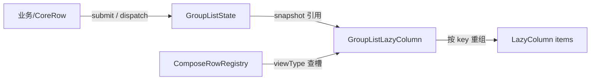

# android-grouplist-compose

分组列表库的 Compose 适配层：`GroupListState`（可观察状态）+ `ComposeRowRegistry`（渲染槽注册）+ `GroupListLazyColumn`（渲染入口）三件套，把 [grouplist-core](../grouplist-core/README.md) 的 `ListSnapshot` 渲染为 `LazyColumn`。

- 坐标：`io.github.xesam:android-grouplist-compose:0.0.1`
- 依赖：`android-grouplist-core`（api）、Compose Foundation / UI（api，BOM `2024.10.01`）
- `minSdk = 21`

## 目录

1. [三件套各是什么](#1-三件套各是什么)
2. [最小接入教程](#2-最小接入教程)
3. [关键契约](#3-关键契约)
4. [与 RecyclerView 层的设计差异](#4-与-recyclerview-层的设计差异)

## 1. 三件套各是什么

| 组件 | 输入 | 职责 |
|---|---|---|
| `GroupListState` | 包装一个 `CoreController` | 可观察快照源：`submit` / `dispatch` 触发重组，无可见变化不失效 |
| `ComposeRowRegistry` | viewType → `@Composable` 槽 | 渲染分发；组合前注册完整，首读后冻结 |
| `GroupListLazyColumn` | `GroupListState` 或裸 `ListSnapshot` | 渲染入口；快照行按 key / contentType 进 `LazyColumn` |



## 2. 最小接入教程

### 2.1 创建可观察状态并提交数据

```kotlin
val state = remember { GroupListState() }

state.submit(coreRows)                    // List<CoreRow>，重载语义
state.toggleGroup(groupKey)               // 展开 / 收起
state.replaceChildren(groupKey, children) // 精确替换子项
```

`GroupListState` 自带（并独占）一个 `CoreController`；也可注入自己构建的 controller。

### 2.2 组合前注册全部渲染槽

```kotlin
val registry = remember {
    ComposeRowRegistry().apply {
        register<CommentHeaderUi>(TYPE_HEADER) { row -> HeaderContent(row) }
        register<CommentUi>(TYPE_ITEM) { row -> CommentContent(row) }
        register<Any>(TYPE_LOADING) { LoadingContent() }
    }
}
```

### 2.3 渲染

```kotlin
GroupListLazyColumn(
    state = state,
    registry = registry,
    itemAnimation = true,          // 展开/收起的 placement 动画，滚动淡入已刻意关闭
    contentPadding = PaddingValues(top = 8.dp, bottom = 14.dp),
)
```

已有自己的生产循环（比如 ViewModel 直接发布 `ListSnapshot`）时，用快照重载：

```kotlin
GroupListLazyColumn(snapshot = viewModel.snapshots.value, registry = registry)
```

完整可运行参考：`app` 模块的 `ComposeDemoActivity.kt`——与 `EngineDemoActivity` 共用同一个 ViewModel，行为一致、只换渲染层。

## 3. 关键契约

- **注册冻结**：所有 `register` 必须在首次组合读取 registry 之前完成（放进 `remember {}` 内）；冻结后再注册会 `fail-fast` 抛错，而不是让后续组合出现布局错乱
- **单 controller 单消费通道**：`GroupListState` 拥有并隐藏内部 controller。不要把同一个 controller 再接一个 `RecyclerView adapter`（排水 `takeChangeSet` 会互相抢帧）；Compose 侧自行从快照推导 diff，不消费 ChangeSet
- **调用时机**：`submit` / `dispatch` 在事件或 effect 回调中调用，不要在组合中途调用（避免双帧）
- **键策略（重组精度）**：组头 / 组尾键 = `kind:groupKey`，组子项键 = `kind:groupKey:childIndex`，普通行键 = **standalone 序号**。因此内容更新原位重组（而不是 remove + insert）；子项增删只影响尾部 key
- **展开态口径**：与 RecyclerView 层一致，由"是否存在可见子行"推断——0 子项的展开组报 false。渲染层只认快照这一个状态源

## 4. 与 RecyclerView 层的设计差异

| 方面 | recyclerview 层 | 本模块 |
|---|---|---|
| diff 来源 | core 的 `ChangeSet` 顺序通知 | Compose 自行按 key 重组，ChangeSet 只排水不消费 |
| viewType | `registerBinder` → ViewHolder | `register` → `@Composable` 槽（同 registry 冻结纪律） |
| 展开 chrome | `submitSnapshotWithGroupChrome` 手动加发 | 展开态在 item 槽内读状态，自动精确重组 |
| 动画 | RecyclerView 局部刷新动画 | `Modifier.animateItem`（仅 placement，淡入淡出置空保滚动性能） |

相关文档：

- 核心概念与完整教程 → [根 README](../README.md)
- 库内部原理（协议与状态机）→ [docs/how-it-works.md](../docs/how-it-works.md)
- Compose 端到端示例 → [app/README.md](../app/README.md)，对应 `ComposeDemoActivity.kt`
