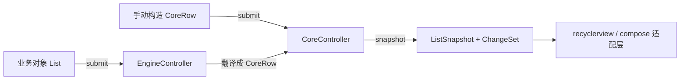

# android-grouplist-core

分组列表库的核心层（纯 JVM，无 Android 依赖）：分组状态机、业务对象解释器与跨层协议都在这一个 artifact 里。RecyclerView / Compose 两个适配层都构建在它之上。

- 坐标：`io.github.xesam:android-grouplist-core:0.0.1`
- 语言：Java 8 兼容
- 依赖：无（纯 JVM；测试用 JUnit 4）

## 目录

1. [这块模块里有什么](#1-这块模块里有什么)
2. [教程：用 Engine 提交业务对象（推荐路径）](#2-教程用-engine-提交业务对象推荐路径)
3. [教程：直接用 Core 手写行结构（进阶路径）](#3-教程直接用-core-手写行结构进阶路径)
4. [命令速查](#4-命令速查)
5. [公开契约要点](#5-公开契约要点)

## 1. 这块模块里有什么

```text
io.github.xesam.android.grouplist.vnext
├── shared   跨层协议：GroupKey / PositionMapping / PositionKind / ListSnapshot / ChangeSet / GroupState + GroupStates
├── core     最小状态机：CoreRow 输入，ListSnapshot + ChangeSet 输出
└── engine   业务对象解释器：GroupSchema + BinderRegistry 把业务对象翻译成 CoreRow
```



一块内容一个职责：

- `shared`：库内与 UI 层的公共语言（谁渲染快照，谁都离不开 `ListSnapshot`）
- `core`：**分组状态机**——展开状态单一事实源、快照生成、精确差分
- `engine`：**解释层**——告诉库"你的业务对象怎么拆成 key / header / children / footer"

## 2. 教程：用 Engine 提交业务对象（推荐路径）

日常业务页面只需要 Engine。四步：

### 2.1 为分组对象定义 GroupSchema

```java
class FeedGroupSchema implements GroupSchema<FeedGroup, String, Comment, String> {
    @Override
    public GroupKey keyOf(FeedGroup group) {
        return GroupKey.of("topic:" + group.topicId); // 必须是稳定业务身份
    }

    @Override
    public String headerOf(FeedGroup group) { return group.topicTitle; }

    @Override
    public List<Comment> childrenOf(FeedGroup group) { return group.comments; }

    @Override
    public String footerOf(FeedGroup group) { return group.hasMore ? "Load more..." : null; }

    @Override
    public boolean initiallyExpanded(FeedGroup group) { return false; }

    @Override
    public boolean showFooterWhenCollapsed(FeedGroup group) { return false; }
}
```

### 2.2 注册 schema 与 viewType，构建 controller

```java
EngineController controller = DefaultEngineController.builder()
        .registerSchema(FeedGroup.class, new FeedGroupSchema())
        .registerGroupHeaderViewType(String.class, TYPE_HEADER)
        .registerGroupItemViewType(Comment.class, TYPE_ITEM)
        .registerGroupFooterViewType(String.class, TYPE_FOOTER)
        .build();
```

viewType 按**角色**注册：同一个类当组头和当组尾可以映射到不同布局（概念见根 README §4.4）。

### 2.3 提交数据、发出意图

```java
controller.submit(groups);                                    // 全量重载（重置展开状态）
controller.dispatch(new EngineCommand.ToggleGroup(groupKey));  // 展开 / 收起
```

### 2.4 消费快照

```java
ListSnapshot snapshot = controller.snapshot(); // 纯只读，可反复调用
```

把 `snapshot` 交给 [grouplist-recyclerview](../grouplist-recyclerview/README.md) 或 [grouplist-compose](../grouplist-compose/README.md) 渲染。

## 3. 教程：直接用 Core 手写行结构（进阶路径）

直接用 Core 的场景：你已经有一套明确的行结构模型，或需要精确控制每一行。Engine 的 schema 全部省去，行结构自己构造：

```java
CoreController controller = new DefaultCoreController();

CoreRow.Group<GroupHeader, Comment, String> group = CoreRow.Group.builder(GroupKey.of("topic:1"))
        .header(header)
        .children(comments)
        .footer("已加载全部")
        .initiallyExpanded(true)
        .childViewTypeResolver((index, child) -> TYPE_ITEM)
        .build();

controller.submit(Arrays.asList(
        CoreRow.Standalone.of(notice, TYPE_NOTICE),  // 普通行：data + viewType
        group
));
```

注意：

- 构造 `Group` 一律走 builder；`build()` 会对契约违约 fail-fast（children 非空时必须提供 resolver）
- `footer == null` 是"无 footer"的唯一判据；此时 `footerViewType` 被忽略

## 4. 命令速查

意图性状态变更只有 `dispatch` 一条通道。两层命令的对照（Engine 命令最终都翻译成 Core 命令执行）：

| 意图 | EngineCommand | CoreCommand | 行为要点 |
|---|---|---|---|
| 展开 / 收起 | `ToggleGroup` / `SetGroupExpanded` | 同名 | 目标态由 controller 从唯一事实源派生 |
| 替换子项 | `ReplaceChildren` | 同名 | 原地 UPDATE + 尾部 INSERT/REMOVE；隐藏组的覆盖保留在 Engine 的 `childrenOverride`（Core 侧对未知/隐藏组为 fail-silent no-op，无缓存） |
| 原位改普通行内容 | `UpdateStandalone.ofIndex/ofData` | `UpdateStandaloneFlat` | 精确单条 UPDATE，无 reload 约束 |
| 切换可见性过滤 | `SetVisibilityFilter` | `ReconcileRows` | 块级精确差分，展开意图跨隐藏存活 |
| 全量重载数据集 | `submit` | `submit` | 重载语义：展开状态重置（公开契约） |
| 键控全量协调 | （无对应 Engine 命令） | `ReplaceRows` | 按 `ItemIdentity` 差分；展开状态**保全**，仅新 key 取 `initiallyExpanded` |

## 5. 公开契约要点

- **线程**：非线程安全；`submit / dispatch / snapshot / takeChangeSet` 必须单线程（通常主线程）调用，无跨线程内存可见性保证——正典表述见 `vnext/package-info.java`
- **失败策略矩阵**：结构性编程错误（null rows、null 元素、重复 GroupKey、计数漂移、越界位置）抛 `IllegalArgumentException` 且**不留半提交状态**；竞态容忍场景（未知 key）fail-silent 不抛
- **双水道**：`submit` = 重载（重置展开态）；增量命令 = 保全（展开意图跨命令、跨隐藏存活）。未换数据集的一切变化都走增量通道
- **ChangeSet 消费协议**：`snapshot()` 纯只读，`hasPendingChanges()` 非消费探测，`takeChangeSet()` 唯一消费点（取走并清空 pending）

相关文档：

- 库内部原理 → [docs/how-it-works.md](../docs/how-it-works.md)
- 完整接入教程 / 核心概念 → [根 README](../README.md)
- 可运行示例（Repository → Mapper → ViewModel → Adapter 全链路）→ [app/README.md](../app/README.md)
