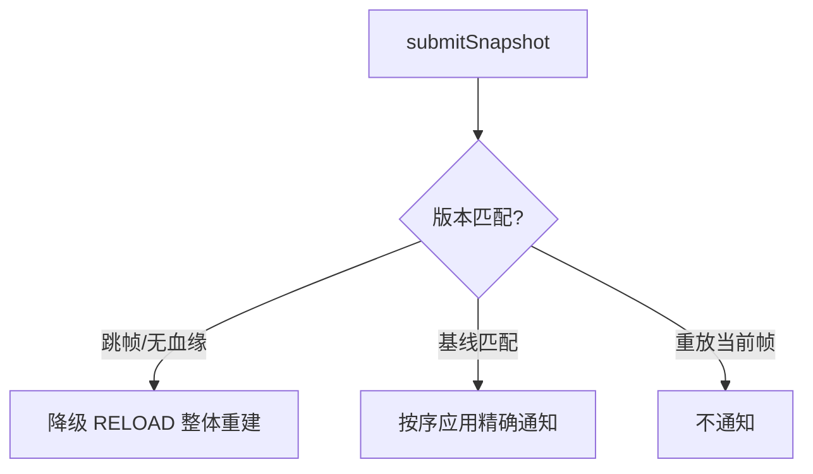

# android-grouplist-recyclerview

分组列表库的 RecyclerView 适配层：把 [grouplist-core](../grouplist-core/README.md) 产出的 `ListSnapshot` 渲染成 `RecyclerView`，并把快照携带的 `ChangeSet` 翻译成精确的 `notifyItemXxx` 通知——只有 RELOAD 通道（`submit`，或版本血缘门降级）整体重建，其余增量一律精确通知，不触发 `notifyDataSetChanged`，滚动与展开动画流畅。

- 坐标：`io.github.xesam:android-grouplist-recyclerview:0.0.1`
- 依赖：`android-grouplist-core`（api）、`androidx.recyclerview:1.4.0`（api）
- `minSdk = 21`

## 目录

1. [最小接入教程](#1-最小接入教程)
2. [刷新语义：ChangeSet 怎么变成通知](#2-刷新语义changeset-怎么变成通知)
3. [组头组尾刷新：submitSnapshotWithGroupChrome](#3-组头组尾刷新submitsnapshotwithgroupchrome)
4. [从快照查询分组信息](#4-从快照查询分组信息)
5. [公开契约要点](#5-公开契约要点)
6. [已有基类 Adapter？组合接入](#6-已有基类-adapter组合接入)

## 1. 最小接入教程

两件事：注册 binder、提交快照。

### 1.1 注册 binder（viewType → 布局与绑定）

每个 viewType 对应一个 `ItemBinder`，在构造后注册一次：

```java
GroupListRecyclerAdapter adapter = new GroupListRecyclerAdapter()
        .registerBinder(TYPE_HEADER, new HeaderBinder())
        .registerBinder(TYPE_ITEM, new CommentBinder())
        .registerBinder(TYPE_FOOTER, new FooterBinder());

recyclerView.setAdapter(adapter);
```

`ItemBinder` 只有两个职责：创建 `ViewHolder`、把 `ListSnapshot.Row` 绑定进去。行数据从 `row.data()` 取，语义位置从 `row.mapping()` 取（kind / groupKey / childIndex）：

```java
class CommentBinder implements ItemBinder {
    @Override
    public RecyclerView.ViewHolder onCreateViewHolder(LayoutInflater inflater, ViewGroup parent) {
        return new CommentHolder(inflater.inflate(R.layout.item_comment, parent, false));
    }

    @Override
    public void onBindViewHolder(RecyclerView.ViewHolder holder, ListSnapshot.Row<?> row, int position) {
        Comment comment = (Comment) row.data();
        // 绑定 ...
    }
}
```

UPDATE 通知携带 `PAYLOAD_CONTENT_UPDATE` payload；需要局部绑定的 binder 覆写 payloads 版本的 `onBindViewHolder`，默认实现回退到全量绑定。

### 1.2 提交快照

```java
adapter.submitSnapshot(controller.snapshot());
```

由 controller 驱动（而不是每次手动提交）时的推荐循环：

```java
controller.dispatch(command);
if (controller.hasPendingChanges()) {
    adapter.submitSnapshot(controller.snapshot());
}
```

> 本 adapter 从**读取**快照消费 ChangeSet，不排水 controller；直接驱动 controller 时，在 `submitSnapshot` 之后调用 `controller.takeChangeSet()` 标记已消费。

## 2. 刷新语义：ChangeSet 怎么变成通知

`submitSnapshot` 按快照携带的 `ChangeSet` 通道分派：

| ChangeSet | 通知行为 |
|---|---|
| `Channel.RELOAD` | `notifyDataSetChanged`（整体重建） |
| `Channel.INCREMENTAL` 空 | **不发任何通知**——重提交相同快照绝不重绘 |
| `Channel.INCREMENTAL` 非空 | 按序 `notifyItemRangeInserted / Removed / Changed` |

另有一道**版本血缘门**：controller 产出的快照带全局版本号，增量 ChangeSet 只在 `baseVersion == 当前显示版本` 时精确应用；跳帧（中间版本缺失）自动降级为整体重建，陈旧坐标永远不会进入 `notify` ——你可以放心地在任意时机提交快照，不用关心消费端落下几帧。



## 3. 组头组尾刷新：submitSnapshotWithGroupChrome

组头 / 组尾的文案常常依赖"当前展开还是收起"（如"展开评论 / 收起评论"），而展开操作的 ChangeSet 只插入/移除子项，不会通知头尾自身。当头尾样式有展开态时改用：

```java
adapter.submitSnapshotWithGroupChrome(controller.snapshot());
```

它会在精确通知之外，对展开态发生变化的组的 header / footer 追加 `notifyItemChanged`。RELOAD 帧已整体重绘，不重复通知。

## 4. 从快照查询分组信息

UI 层不需要自己维护一份易漂移的分组状态 map，adapter 提供快照派生的只读查询：

- `isGroupExpanded(groupKey)` / `isGroupExpandedAt(position)` —— 展开态推断
- `getGroupState(groupKey)` —— header / footer 位置与可见行数
- `findGroupHeaderPosition(groupKey)` / `findGroupFooterPosition(groupKey)`
- `expandGroup / collapseGroup / setGroupExpanded / setGroupsExpanded` —— 转发意图的便捷入口，默认不落地；子类可覆写 `requestSetGroupExpanded` 桥接到自己的 controller

已知口径（契约）：`expanded` 由"是否存在可见子行"推断，**有 0 个子项的展开组会报 `false`**——纯快照无法区分二者。`GroupState` 类型与推导逻辑来自 core 模块（`vnext.shared.GroupState` / `GroupStates`），作为供两个适配层共用的单一事实源。

## 5. 公开契约要点

- **线程**：主线程调用（RecyclerView 通知契约 + core 层单线程契约）
- **stableIds 未启用**：本版本不支持 `setHasStableIds`（standalone 行跨重提交无稳定 id）
- **binder 注册**：同一 viewType 重复注册后者生效；未注册的 viewType 在绑定时抛 `IllegalStateException`
- **设计取舍**：registry 内部用 JDK `LinkedHashMap`（Integer 装箱）而非 `SparseArray`，换取本模块单测可脱离 Robolectric 在纯 JVM 运行

相关文档：

- 库内部原理 → [docs/how-it-works.md](../docs/how-it-works.md)
- 核心概念与完整教程 → [根 README](../README.md)
- 真实场景示例（本 adapter 的完整用法）→ [app/README.md](../app/README.md)，对应 `DemoUiAdapter.java`

## 6. 已有基类 Adapter？组合接入

`GroupListRecyclerAdapter` 是**继承入口**：一个薄转发门面，protected 钩子（`requestSetGroupExpanded`、`notifyXxxCompat` 族、`dispatchNotifyDataSetChanged`）原位保留，子类覆写零感知生效。

当 `extends` 名额被自家基类占用时（Java 单继承），改用**组合入口** `SnapshotAdapterDelegate`——它是本层唯一真实实现（行存储、版本门、ChangeSet 翻译、GroupState 缓存全部在内）。门面只是纯转发，两条路径共享这一份实现，由两套测试分别钉住只有本入口会坏的接线（facade：`CompatNotifier` → protected 钩子；delegate：Notifier 回调通路）：

```java
class FeedAdapter extends CompanyBaseAdapter {   // 你自己的基类，继承名被占用

    private final SnapshotAdapterDelegate delegate =
            new SnapshotAdapterDelegate(new AdapterNotifier(this)); // 通知从本实例发出

    FeedAdapter(EngineController engine) {
        delegate.registerBinder(TYPE_HEADER, new HeaderBinder())
                .registerBinder(TYPE_ITEM, new CommentBinder());

        // 展开意图上抛——继承路径对应"覆写 requestSetGroupExpanded 钩子"
        delegate.setOnExpansionRequest((groupKey, expanded) -> {
            engine.dispatch(new EngineCommand.ToggleGroup(groupKey));
            return true;
        });
    }

    // Adapter 方法转发（含 payloads 版本：缺了它 PAYLOAD_CONTENT_UPDATE 的
    // partial rebind 会退化为全量重绑）
    @Override public int getItemCount() { return delegate.getItemCount(); }
    @Override public int getItemViewType(int position) { return delegate.getItemViewType(position); }
    @Override public RecyclerView.ViewHolder onCreateViewHolder(ViewGroup parent, int viewType) {
        return delegate.onCreateViewHolder(LayoutInflater.from(parent.getContext()), parent, viewType);
    }
    @Override public void onBindViewHolder(RecyclerView.ViewHolder holder, int position) {
        delegate.onBindViewHolder(holder, position);
    }
    @Override public void onBindViewHolder(RecyclerView.ViewHolder holder, int position, List<Object> payloads) {
        delegate.onBindViewHolder(holder, position, payloads);
    }

    // 快照提交与 group 查询同款 API
    void submit(ListSnapshot snapshot) { delegate.submitSnapshotWithGroupChrome(snapshot); }
    GroupState groupState(GroupKey key) { return delegate.getGroupState(key); }
}
```

对照表：

| | 继承（`GroupListRecyclerAdapter`） | 组合（`SnapshotAdapterDelegate`） |
|---|---|---|
| 展开意图 | 覆写 protected `requestSetGroupExpanded` | `setOnExpansionRequest` 回调 |
| 定制通知 | 覆写 protected `notifyXxxCompat` 族 | 实现 `SnapshotAdapterDelegate.Notifier`（默认用 `AdapterNotifier`） |
| 双通道冲突 | 不存在（门面不暴露 delegate）——结构保证，非文档约定 | 同左 |

完整可运行示例：示例 App 的「组合接入示例页」（`DelegateDemoActivity` + `DelegatingDemoAdapter`），与 Engine 页共用同一 ViewModel。内部结构与决策记录见 [docs/how-it-works.md](../docs/how-it-works.md) §5.5。
